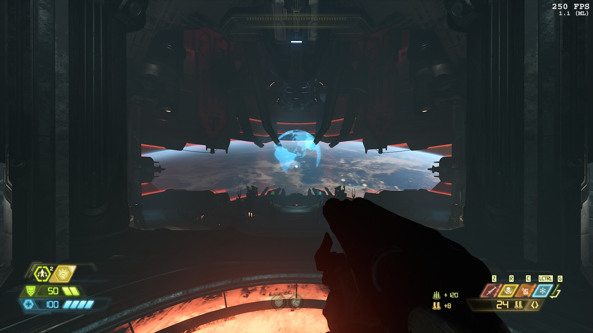
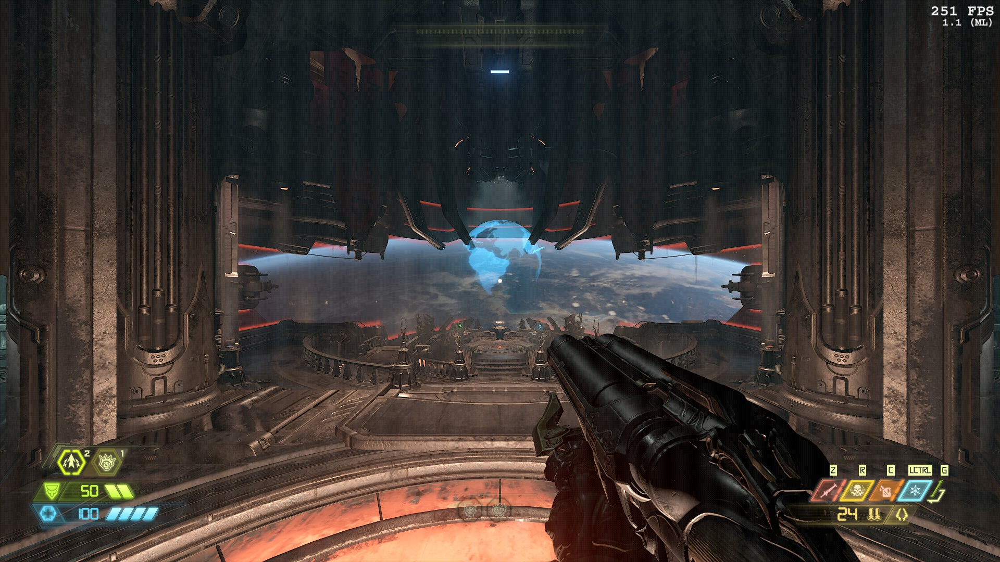

# DoomEternal-v1.1--RTXFix — исправление освещения окружения в DOOM Eternal 1.1 на NVIDIA

[English](README.md) | **Русский**

На современных драйверах NVIDIA DOOM Eternal **1.1** рисует затенённые части оружия от первого лица полностью чёрными,
а в мире пропадают локальные источники света, декали и объёмный свет. doomfix — небольшой Vulkan-слой, который это
исправляет **без отката драйвера на 516.94**, а на RTX 40 и RTX 50 такой откат и вовсе невозможен.

| До | После |
|---|---|
|  |  |

## Это безопасно?

- Это **Vulkan-слой**: дополнение того же рода, что используют ReShade, MSI Afterburner / RivaTuner и оверлей Steam.
  Windows подгружает его в игру при запуске.
- **Файлы игры не меняются.** В папке игры ничего не трогается.
- **Геймплей и тайминги не затрагиваются.** Слой добавляет один флаг синхронизации в три барьера GPU в коде
  освещения игры, ровно как это сделали сами id Software в поздних патчах. Всё остальное проходит без изменений.
- **Открытый исходный код** (лицензия MIT): можно прочитать каждую строку и собрать самому.
- **Легко удалить:** `uninstall.bat` убирает его полностью.

## Совместимость

| | |
|---|---|
| **Проверено** | GeForce RTX 4070, драйвер NVIDIA 617.42, DOOM Eternal 1.1 (Steam) |
| **Должно работать** | на любой видеокарте NVIDIA с новым драйвером, где есть баг с чёрным оружием |
| **AMD** | на AMD этой проблемы нет; слой там ничего не ломает |
| **ОС** | только Windows (64-бит) |

Попробовали на другой видеокарте или драйвере? Пожалуйста, напишите о результате, удачном или нет, в [Issues](../../issues):
видеокарта, версия драйвера, версия игры и выглядит ли оружие правильно.

## Установка

> **Готовых сборок пока нет**, поэтому сейчас doomfix нужно собрать из исходников:
> см. [docs/BUILDING.md](docs/BUILDING.md) (на английском). Готовые версии появятся на странице [Releases](../../releases),
> и тогда установка будет такой:

1. Скачайте последний `doomfix-<версия>.zip` со страницы [Releases](../../releases).
2. Распакуйте его в любое место, например в `Документы\doomfix`. Эту папку не удаляйте: в ней лежат лаунчер и деинсталлятор.
3. Запустите `install.bat`. Права администратора не нужны.
4. Запускайте игру через `run_doom_fixed.bat`.

## Использование

### Запуск игры

Дважды щёлкните **`run_doom_fixed.bat`**. Это всё.

При первом запуске он найдёт DOOM Eternal в вашей библиотеке Steam и попросит подтвердить папку (или ввести путь,
если игра установлена в другом месте). Папка запоминается, и дальше игра просто запускается. Steam должен быть запущен.

**По желанию, запуск из Steam:** если вам удобнее нажимать «Играть» в Steam, один раз запустите `enable_steam_mode.bat`
(он предложит сам перезапустить Steam). `disable_steam_mode.bat` выключает это обратно.

### Как проверить, что всё работает

При каждом запуске игры пишется лог `%LOCALAPPDATA%\doomfix\logs\DOOMEternalx64vk_<дата-время>_<pid>.log`.
Когда вы окажетесь на уровне, в нём должны быть такие строки:

```
INFO  doomfix 0.3.0 (VK_LAYER_DOOMFIX) loaded into <папка игры>\DOOMEternalx64vk.exe, pid 1234
INFO  indirect-barrier-fix [on]: PATCHED vkCmdPipelineBarrier in command buffer 000002CD804070D0
INFO  indirect-barrier-fix [on]: barriers with DRAW_INDIRECT dst 1800 (+1800), patched 1800 (+1800), ...
```

Последняя строка повторяется каждые несколько секунд, пока вы играете, и числа в ней растут.

### Режимы

У фикса четыре режима, их выбирает переменная `DOOMFIX_INDIRECT_FIX`. Для каждого режима есть свой лаунчер:

| Режим | Лаунчер | Что делает |
|---|---|---|
| `on` (по умолчанию) | `run_doom_fixed.bat` | Фикс, ровно такой же, как сделали id Software в поздних патчах. Используйте этот. |
| `strict` | `run_fix_strict.bat` | `on` плюс одно дополнительное ожидание для надёжности (так работал `on` в v0.2). Попробуйте, если в `on` когда-нибудь появится мерцание или пропадут источники света. |
| `off` | `run_fix_off.bat` | Слой загружен, но ничего не меняет — чтобы сравнить «до» и «после». |
| `aggressive` | `run_fix_aggressive.bat` | Использует более тяжёлые барьеры «дождаться всего». Запасной вариант на случай, если `on` когда-нибудь окажется недостаточно; обычно не нужен. |

## Удаление

1. Запустите `uninstall.bat`.
2. Удалите папку doomfix.
3. По желанию: удалите `%LOCALAPPDATA%\doomfix` (там остаются только логи).

## Решение проблем

**Игра запускается, но оружие всё ещё чёрное и нового лога нет.**
DOOM Eternal может перезапустить себя через Steam, и перезапущенная игра уже не получает переменные doomfix.
Лаунчер предотвращает это, задавая `SteamAppId=782330`; убедитесь, что Steam запущен, прежде чем им пользоваться.
Если вы запускаете игру из Steam, запустите `enable_steam_mode.bat` и дайте ему перезапустить Steam.

**`install.bat` предупреждает о другом файле настроек loader'а.**
Этот файл создаёт Vulkan Configurator (vkconfig) из состава Vulkan SDK. Загрузчик Vulkan использует только один такой
файл, поэтому doomfix его не перезаписывает. Закройте vkconfig или выключите в нём «Vulkan Loader Management» и
запустите `install.bat` ещё раз.

**Антивирус ругается на `doomfix_layer.dll`.**
DLL не подписана цифровой подписью и подгружается в игру так же, как оверлей, а некоторым антивирусам это не нравится.
Исходный код открыт: можно собрать DLL самому ([docs/BUILDING.md](docs/BUILDING.md)) и/или добавить исключение для папки
doomfix и для `%LOCALAPPDATA%\doomfix\layer`.

**Лога нет совсем.**
Проверьте, что `install.bat` завершился без ошибок и что игра запущена с `DOOMFIX_ENABLE=1` (через лаунчер или из
Steam после `enable_steam_mode.bat`). `run_doom_fixed.bat -DryRun` проверяет установку и папку игры, не запуская игру.

## Как это работает

Каждый кадр DOOM Eternal раскладывает источники света, декали и пробы отражений по трёхмерной сетке маленьких
«кластеров» прямо на видеокарте. Это происходит в два шага: первый шаг записывает, сколько работы предстоит второму,
а второй шаг читает эти числа. Перед чтением игра должна сказать видеокарте, чтобы та сделала свежезаписанные числа
видимыми, а версия 1.1 забывает для этого один флаг (`VK_ACCESS_INDIRECT_COMMAND_READ_BIT`) в трёх местах.
Видеокарты AMD всё равно видят правильные числа; современные драйверы NVIDIA читают устаревшие нули, поэтому в каждом
кластере остаётся только солнце, и оружие в тени не получает света совсем. doomfix добавляет недостающий флаг, пока игра
записывает свои команды для видеокарты, — то же изменение, которое id Software сделали в поздних обновлениях.

Подробнее: [docs/TECHNICAL.md](docs/TECHNICAL.md) (на английском). Полное расследование с захватами RenderDoc и
сравнением с актуальной версией игры: [analysis/report.md](analysis/report.md).

## Благодарности

- **billymooreq**: расследование и фикс.
- Расследование и код сделаны с помощью [Claude Code](https://claude.com/claude-code) от Anthropic.
- Инструменты: [RenderDoc](https://renderdoc.org) Baldur Karlsson (анализ захватов),
  [Vulkan-Headers](https://github.com/KhronosGroup/Vulkan-Headers) от Khronos,
  [SPIRV-Cross](https://github.com/KhronosGroup/SPIRV-Cross).
- DOOM Eternal © id Software / Bethesda. Проект с ними не связан и ими не одобрен.

## Лицензия

[MIT](LICENSE)
